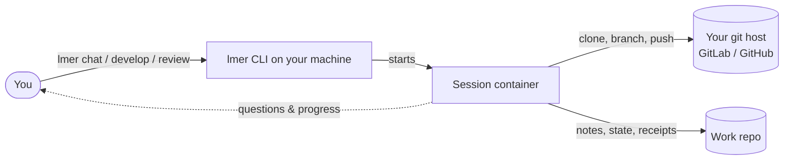
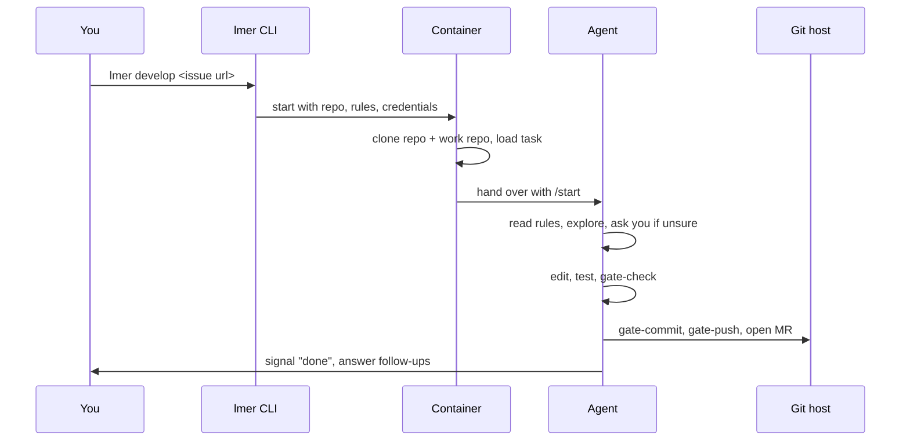
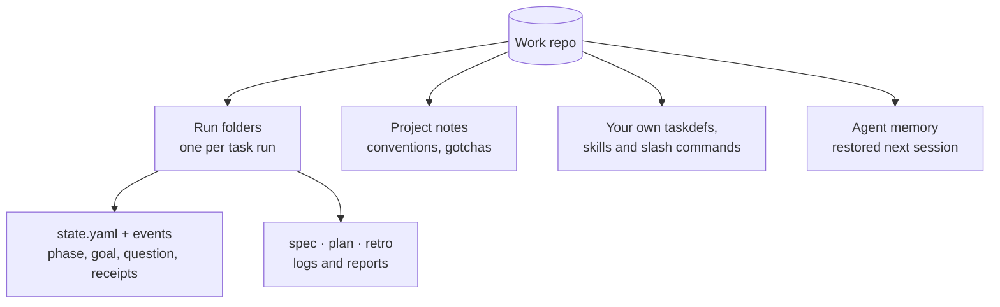
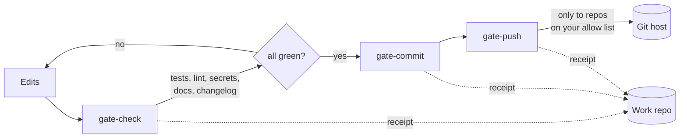
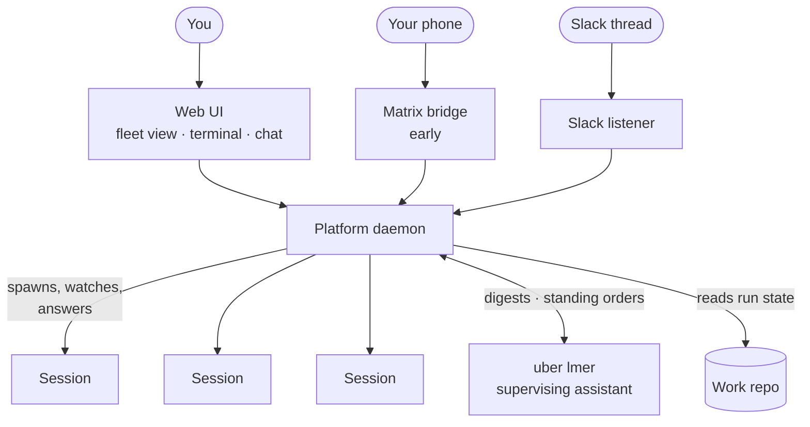
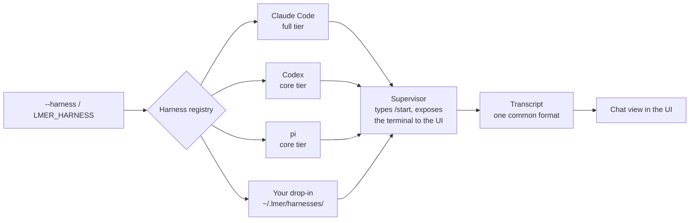
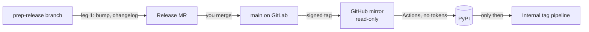

# How lmer works

A one-page tour of lmer's moving parts and how they fit together, written
for the person who *uses* lmer rather than the person who maintains it.
Each section is one small picture and a few sentences. Follow the links at
the end of a section when you want the full reference.

Features that are still early are tagged **(early)** so you know what is
solid and what is a first slice.

## 1. The big picture

You point lmer at a repository (or an issue, MR or PR in one) and pick a
task. lmer starts a fresh, throw-away container, puts your repository, a
set of house rules and an AI coding agent inside it, and lets the agent
work. Everything the session learns or produces that is *not* code goes to
a second repository — the **work repo** — so nothing is lost when the
container disappears.

Three things never change:

- Your host machine stays clean — tests, pre-commit and git all run inside
  the container.
- Credentials are mounted into the container, never written into the
  repository you are working on.
- The container is disposable; the work repo is the memory.

See [LMER-CLI.md](./LMER-CLI.md) and [CONTAINER.md](./CONTAINER.md).

## 2. The life of one session

Every session follows the same shape, whatever the task.

What the agent gets at start-up, in order:

1. **Rules** — `AGENTS.md` and `rules/`, the same house rules in every
   project. If the repository has none, lmer provides defaults (and keeps
   them out of your git status).
2. **A task** — a *taskdef* such as `chat`, `develop`, `review` or
   `release`: step-by-step instructions the agent reads when it types
   `/start`. Only `chat` ships with lmer; the rest come from your work repo.
3. **Tools** — slash commands (`/gate-commit`, `/gitlab-review`, …),
   helper agents, and the `work` CLI.
4. **Context about you** — who the human is, how to reach you, what to do
   when nobody is watching.

See [TASKDEFS.md](./TASKDEFS.md), [PROMPT-FRAGMENTS.md](./PROMPT-FRAGMENTS.md)
and [DOCUMENTATION-PROVISIONING.md](./DOCUMENTATION-PROVISIONING.md).

## 3. The work repo: lmer's memory

The work repo is an ordinary git repository you own. lmer clones it into
every container and pushes it back as the session goes. It holds no code
from your projects — only what lmer needs to remember.

Why this matters to you:

- **A run survives its container.** If a session dies or is stopped with a
  question, the next session reads the run folder and continues where it
  left off — it does not start over.
- **"Done" needs a receipt.** Gate commands and `work verify` write proof of
  what actually ran into the run's event log. The tool writes the receipt,
  not the agent, so a claim of "tests pass" can be checked.
- **Your conventions travel.** Notes you put in a project's `info/` folder
  are read by every agent that opens that project.

See [RUN-STATE.md](./RUN-STATE.md).

## 4. Gates: how code leaves the container

Nothing is committed or pushed by hand. The agent must go through the gate
commands, and the gates enforce the rules regardless of what the agent
intended.

- A push is only possible to repositories you have explicitly allowed.
- A change that only touches prose runs just the tests that read prose;
  anything else runs the full suite. When in doubt the gate runs more, never
  less.
- Every gate run leaves a receipt in the run's event log.

See [GATE-FASTPATH.md](./GATE-FASTPATH.md) and the rules in `rules/`.

## 5. The platform: running many sessions at once

One session at a time is the `lmer` command. Running a fleet is the
**platform**: a small daemon on your host with a web UI, plus a supervising
assistant — "uber lmer" — that is itself an lmer session with no repository,
so it can steer but structurally cannot write code.

How a running session reaches you:

- **One channel, both directions** — the supervisor inside the container keeps
  the session's message bus. An agent that needs a decision runs
  `lmer-signal ask`; the question appears in the chat pane, in a connected
  Slack thread and in a connected matrix thread at once, the first answer from
  any of them wins, and the others see who answered. Whatever anyone types in
  any of those channels reaches the agent as a turn tagged with its source
  (`[slack · tester] …`). See [COMMS.md](./COMMS.md).
- **Signals** — milestones (`lmer-signal "MR pushed"`) ride the same bus and
  reach uber lmer, which decides what to spawn or wind down next.
- **Digests** — the daemon, not an AI, notices when a run needs attention or
  has stopped, and nudges uber lmer once when it goes quiet.
- **Uploads** — a screenshot or log you attach in chat lands in the
  container as a file the agent can read.

The Slack listener connects one Slack thread to one chat session. The Matrix
bridge **(early)** announces runs that need a human and lets allow-listed
people answer from a phone; steering runs from Matrix is not there yet. The
platform can also run as its own container image **(early)**.

See [PLATFORM-QUICKSTART.md](./PLATFORM-QUICKSTART.md),
[MATRIX-CHAT.md](./MATRIX-CHAT.md) and
[PLATFORM-CONTAINER.md](./PLATFORM-CONTAINER.md).

## 6. Harnesses: which agent runs inside

The "agent" is an off-the-shelf coding CLI. lmer wraps whichever one you
choose behind the same rules, tasks and gates.

- Claude Code is the default and most complete; Codex and pi cover the core
  workflow. A capability matrix tells you exactly what differs.
- Adding another CLI does not need a fork: drop a manifest and a runner
  script into `~/.lmer/harnesses/`. A worked example exists for opencode.
- Whatever the harness, its session is converted to one transcript format,
  so the platform's chat view reads the same for all of them.

See [HARNESSES.md](./HARNESSES.md), [USER-HARNESS-OPENCODE.md](./USER-HARNESS-OPENCODE.md)
and [TRANSCRIPT-FORMAT.md](./TRANSCRIPT-FORMAT.md).

## 7. Reusing a running stack and fanning out

Two ways to shape a session beyond "clone and run":

- **Service mode** — instead of cloning, lmer attaches to a project that is
  already running (a compose stack with its database), so tests that need a
  real environment just work. **Presets** name such a setup so you can pick
  it by name from the CLI or a Slack message, and **service slots** stop two
  agents from landing on the same database.
- **Fan-out** — from inside a session an agent can start short-lived child
  agents for parallel sub-tasks. Children are stateless, cannot ask you
  questions and cannot fan out further.

See [SERVICE-MODE.md](./SERVICE-MODE.md) and [PRESETS.md](./PRESETS.md).

## 8. Releasing lmer itself (brief)

A release is just another tracked lmer run, with a human merge in the middle.

GitLab is the source of truth, GitHub is a mirror and publish target, PyPI
is fed by trusted publishing (no long-lived tokens), and nothing internal
publishes until the public step is green.

See [RELEASE-FLOW.md](./RELEASE-FLOW.md).

## Why this design works for you

1. **Your machine stays clean.** Tests, linters and git run in a disposable
   container, not on your host.
2. **Credentials stay out of your code.** Tokens are mounted in, scoped to
   the host that issued them, and never land in a working tree or commit.
3. **The same rules everywhere.** One `AGENTS.md` + `rules/` set is
   injected into every session, in every project, on every harness.
4. **Rules are enforced, not just requested.** Gate commands and stop-hooks
   check what the agent did; a prompt alone is never the safety net.
5. **Pushes go only where you allow.** An explicit allow list decides which
   repositories and refs an agent may push to.
6. **Runs survive crashes and questions.** Durable run state in the work
   repo means the next session resumes, it does not restart.
7. **"Done" comes with a receipt.** Gate and verify results are written by
   the tool, so progress claims can be audited after the fact.
8. **Nobody has to babysit.** The platform detects attention mechanically
   and a supervising assistant handles the routine; you are asked only when
   a decision is really yours.
9. **Answer from anywhere.** Questions reach the web UI, Slack or your
   phone, and an answer continues the exact run that asked.
10. **Pick your agent.** Claude Code, Codex, pi, or your own CLI via a
    drop-in — same tasks, same gates, same chat view.
11. **Your conventions ride along.** Per-project notes, taskdefs and skills
    in the work repo are read by every agent that opens the project.
12. **Real environments, safely shared.** Service mode reuses a running
    stack; slots keep agents from colliding on it.
13. **A compliant base.** The session image is built on a FIPS-capable
    base and runs on Docker or Podman.
14. **Releases are boring on purpose.** Signed tags, tokenless publishing
    and a public-before-internal order make shipping a checklist, not an
    event.
